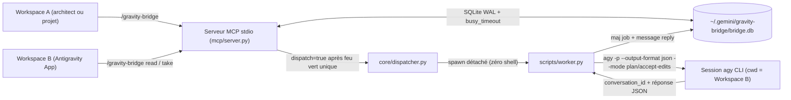

# Spécification d'Architecture — Gravity Bridge (`v0.1.0`)

> **Statut :** Spécification verrouillée (post `/grill-me`) — Prête pour création du dépôt autonome `gravity-bridge`  
> **Cible :** Plugin Antigravity compagnon (`BSourichanh/gravity-bridge`, ex. `../gravity-bridge`)  
> **Contrainte cœur :** **100 % bibliothèque standard Python 3**, zéro dépendance tierce, zéro hook permanent, zéro fichier déposé dans les workspaces cibles.

---

## 1. Résumé exécutif

**Gravity Bridge** (`gravity-bridge` / `/gravity-bridge`) est un plugin Antigravity autonome conçu pour supprimer les transferts manuels de fichiers `.md` entre workspaces locaux tout en respectant strictement l'isolation par dossier de chaque dépôt.

Dans l'écosystème actuel :
- La réflexion, l'architecture multi-projets et le cadrage ont lieu dans l'atelier (`gravity-architect`).
- Chaque projet cible (`gravity`, `gravity-metrics`, etc.) dispose d'un périmètre propre (ses `AGENTS.md`, règles, hooks et tests).

**Ce que permet `gravity-bridge` :**
1. **Depuis l'atelier (`architect`) :** après **une validation humaine unique**, l'agent enregistre un fil typé (`question`, `handoff`, `info`) dans une boîte aux lettres SQLite centralisée et **instancie automatiquement en tâche de fond** une session `agy -p` isolée dans le dossier du projet cible (`cwd` cible, règles et `AGENTS.md` cibles actifs).
2. **En retour et en pair-à-pair :** la session cible écrit sa réponse et son `conversation_id` dans le même fil ; l'atelier ou tout autre projet peut lire le résultat, relancer la conversation cible (`--conversation <id>`), ou consulter la boîte aux lettres à la demande depuis **Antigravity App** en tapant `/gravity-bridge`.

> [!IMPORTANT]
> **Limite native vérifiée d'Antigravity :** Les conversations d'**Antigravity App (2.0)** (`~/.gemini/antigravity/`) et celles du CLI **`agy`** (`~/.gemini/antigravity-cli/`) sont séparées. Aucune API officielle, commande CLI ni schéma d'URI ne permet aujourd'hui à un plugin de créer automatiquement un nouvel onglet dans la barre latérale d'un autre projet de l'App Desktop (et `gravity-bridge` ne touche jamais aux bases internes de l'App). Les sessions instanciées automatiquement tournent via le CLI officiel **`agy -p`** avec reprise multi-tours via `--conversation <id>`, tandis que tous leurs statuts, fils et réponses restent centralisés dans SQLite et consultables directement dans l'App via `/gravity-bridge`.

---

## 2. Décisions d'architecture verrouillées

| Axe | Décision retenue | Justification |
| :--- | :--- | :--- |
| **Périmètre** | Communication inter-workspaces locaux (atelier ↔ projets ou projet ↔ projet) | Chaque dépôt garde 1 dossier = 1 périmètre ; zéro pollution entre dépôts |
| **Mode d'exécution** | Hybride : boîte aux lettres SQLite + instanciation asynchrone `agy -p` non-bloquante | Permet un feu vert unique côté `architect` et des appels parallèles sans timeout MCP |
| **Modèle de messages** | Fils typés légers (`question`, `handoff`, `info`, `reply`), statuts `open` / `done`, `file_refs` informatifs | Suffisant pour cadrage, questions rapides et exécution de lots sans usine à tickets |
| **Packaging** | Dépôt Git & plugin compagnon autonome (`BSourichanh/gravity-bridge`) | Utilisable sur tout projet Antigravity, indépendamment de `gravity` ou `gravity-architect` |
| **Primitives natives** | Serveur MCP stdio (lazy-loadé) + Skill `/gravity-bridge` + règle légère `rules/AGENTS.md` | **Zéro hook permanent** : 0 ms d'impact sur les sessions normales ; fonctionne même sous Sandbox |
| **Découverte** | Enregistrement à la demande au premier `/gravity-bridge` ou au ciblage d'un dossier local existant | Pas d'auto-scan au `SessionStart` ; support natif du multi-racines |
| **Stockage** | SQLite stdlib (`sqlite3`, mode `WAL`) dans `~/.gemini/gravity-bridge/bridge.db` (`$GRAVITY_BRIDGE_HOME`) | 1 fichier atomique gérant nativement la concurrence multi-processus Windows/POSIX |
| **Sécurité** | Isolation fichiers stricte, plafond 32 Ko/message, filtre secrets, anti-boucle `DEPTH=1`, `--mode` adapté | Jamais `--dangerously-skip-permissions` ; respect strict des hooks et règles cibles |
| **Interface v1** | 100 % conversationnelle en Markdown synthétique | Empreinte minimale, identique sur Antigravity App, IDE et `agy` CLI |

---

## 3. Architecture & Flux d'exécution



### Scénarios nominaux

1. **Envoi avec instanciation automatique (flux principal `architect` → `projet`) :**
   - Dans `architect`, l'utilisateur valide le brief/handoff proposé.
   - L'agent appelle `send_message(..., to_workspace="gravity-metrics", msg_type="handoff", approved=True, dispatch=True)`.
   - Le serveur MCP écrit le fil + message dans `bridge.db`, crée un job `queued`, spawne `scripts/worker.py` en processus détaché et retourne immédiatement `{thread_id, message_id, job}`.
   - `worker.py` exécute `agy -p ... --output-format json --mode accept-edits` dans `cwd` = chemin canonique de `gravity-metrics`, capture `conversation_id` + `response`, les enregistre dans SQLite et passe le job à `completed`.
   - Dans `architect`, `/gravity-bridge status` ou `/gravity-bridge read <thread_id>` affiche le rapport synthétique de retour.
2. **Suivi multi-tours sur la même session cible :**
   - Si la réponse cible soulève une précision, `architect` répond avec `reply_thread(thread_id, ..., dispatch=True)` : le worker relance `agy -p` avec `--conversation <target_conversation_id>` afin de conserver tout le contexte précédent du projet cible.
3. **Mode boîte aux lettres manuelle (Antigravity App uniquement) :**
   - L'envoi se fait avec `dispatch=False` (`approved=True` ou `False`).
   - L'utilisateur ouvre le projet B dans Antigravity App, tape `/gravity-bridge`, lit le fil via `read_thread` (ou exécute via `/gravity-bridge take <thread_id>`) et clôture via `reply_thread(..., close=True)`.

---

## 4. Stockage centralisé SQLite (`~/.gemini/gravity-bridge/bridge.db`)

### 4.1 Résolution du répertoire et pragmas

- Variable d'environnement prioritaire : `GRAVITY_BRIDGE_HOME` (utile pour les tests isolés), sinon `Path.home() / ".gemini" / "gravity-bridge"`.
- Création automatique du dossier parent au premier accès (`mkdir(parents=True, exist_ok=True)`).
- Connexions ouvertes avec `sqlite3.connect(..., timeout=5.0, isolation_level=None)` et transactions explicites `BEGIN IMMEDIATE` / `COMMIT` / `ROLLBACK` pour les écritures concurrentes multi-processus sous WAL.
- Pragmas appliqués à **chaque** ouverture de connexion :

```sql
PRAGMA journal_mode = WAL;
PRAGMA synchronous = NORMAL;
PRAGMA busy_timeout = 5000;
PRAGMA foreign_keys = ON;
```

### 4.2 Schéma DDL complet

```sql
CREATE TABLE IF NOT EXISTS workspaces (
    slug           TEXT PRIMARY KEY,
    canonical_path TEXT UNIQUE NOT NULL,
    display_name   TEXT NOT NULL,
    created_at     TEXT NOT NULL,
    last_seen_at   TEXT NOT NULL
);

CREATE TABLE IF NOT EXISTS threads (
    id                     TEXT PRIMARY KEY,
    from_workspace         TEXT NOT NULL REFERENCES workspaces(slug),
    to_workspace           TEXT NOT NULL REFERENCES workspaces(slug),
    msg_type               TEXT NOT NULL CHECK (msg_type IN ('question', 'handoff', 'info')),
    subject                TEXT NOT NULL,
    status                 TEXT NOT NULL CHECK (status IN ('open', 'done')) DEFAULT 'open',
    approved               INTEGER NOT NULL DEFAULT 0 CHECK (approved IN (0, 1)),
    target_conversation_id TEXT,
    created_at             TEXT NOT NULL,
    updated_at             TEXT NOT NULL
);

CREATE TABLE IF NOT EXISTS messages (
    id               INTEGER PRIMARY KEY AUTOINCREMENT,
    thread_id        TEXT NOT NULL REFERENCES threads(id) ON DELETE CASCADE,
    sender_workspace TEXT NOT NULL REFERENCES workspaces(slug),
    msg_type         TEXT NOT NULL CHECK (msg_type IN ('question', 'handoff', 'info', 'reply')),
    body             TEXT NOT NULL,
    file_refs_json   TEXT NOT NULL DEFAULT '[]',
    is_read          INTEGER NOT NULL DEFAULT 0 CHECK (is_read IN (0, 1)),
    created_at       TEXT NOT NULL
);

CREATE TABLE IF NOT EXISTS jobs (
    id                     TEXT PRIMARY KEY,
    thread_id              TEXT NOT NULL REFERENCES threads(id) ON DELETE CASCADE,
    message_id             INTEGER NOT NULL REFERENCES messages(id) ON DELETE CASCADE,
    target_workspace       TEXT NOT NULL REFERENCES workspaces(slug),
    mode                   TEXT NOT NULL CHECK (mode IN ('plan', 'accept-edits')),
    timeout_seconds        INTEGER NOT NULL DEFAULT 300 CHECK (timeout_seconds BETWEEN 30 AND 900),
    status                 TEXT NOT NULL CHECK (
                               status IN ('queued', 'running', 'completed', 'failed', 'timed_out', 'cancelled')
                           ),
    pid                    INTEGER,
    child_pid              INTEGER,
    target_conversation_id TEXT,
    model                  TEXT,
    effort                 TEXT,
    exit_code              INTEGER,
    error_summary          TEXT,
    duration_ms            INTEGER,
    started_at             TEXT,
    finished_at            TEXT,
    created_at             TEXT NOT NULL
);

CREATE INDEX IF NOT EXISTS idx_threads_to_status   ON threads(to_workspace, status, updated_at DESC);
CREATE INDEX IF NOT EXISTS idx_threads_from_status ON threads(from_workspace, status, updated_at DESC);
CREATE INDEX IF NOT EXISTS idx_messages_thread     ON messages(thread_id, id ASC);
CREATE INDEX IF NOT EXISTS idx_jobs_thread_status  ON jobs(thread_id, status, created_at DESC);
CREATE UNIQUE INDEX IF NOT EXISTS idx_jobs_one_active_per_thread
    ON jobs(thread_id) WHERE status IN ('queued', 'running');
```

### 4.3 Règles de cohérence et réconciliation

- **Identifiants :** `thread_id` au format lisible et triable `thr-<YYYYMMDD>-<hex6>` ; `job_id` au format `job-<YYYYMMDD>-<hex6>`. Horodatages ISO 8601 UTC (`YYYY-MM-DDTHH:MM:SSZ`).
- **Normalisation des chemins :** sous Windows, `canonical_path` résout le chemin réel sur disque (`Path.resolve(strict=True)`), supprime un éventuel préfixe `\\?\`, force la lettre de lecteur en majuscule (`D:\...`) et déduplique sans tenir compte de la casse pour éviter les doublons dans `workspaces`.
- **Lecture non destructive :** `list_inbox` ne modifie jamais `is_read`.
- **Marquage de lecture ciblé :** `read_thread` passe `is_read = 1` uniquement pour les messages du fil où `sender_workspace != reader_workspace` (et seulement si `mark_read=True` et `reader_workspace` est fourni).
- **Réconciliation des jobs orphelins :** lors de `list_inbox`, `read_thread`, `list_workspaces`, `create_job` ou `manage_thread(action="get_job")`, tout job en statut `queued`/`running` dont :
  - le `pid` n'existe plus (POSIX : `os.kill(pid, 0)` ; Windows : `OpenProcess(PROCESS_QUERY_LIMITED_INFORMATION, False, pid)` + `GetExitCodeProcess` comparé à `STILL_ACTIVE == 259` avec `CloseHandle` systématique, `ERROR_ACCESS_DENIED` considéré vivant) ;
  - ou `status = 'queued' AND pid IS NULL` dépasse `QUEUED_GRACE_SECONDS = 30` secondes depuis `created_at` ;
  - ou l'exécution dépasse `jobs.timeout_seconds + 30 s` depuis `started_at` (ou `created_at`) ;
  est automatiquement basculé en `failed` avec `error_summary = "Processus worker interrompu ou orphelin"`.

---

## 5. Contrat des outils MCP (`mcp/server.py`)

Le serveur implémente JSON-RPC 2.0 sur `stdin`/`stdout` (protocole MCP `2025-06-18`, aligné sur `gravity-metrics-plugin/mcp/server.py`), déclaré dans `mcp_config.json` sous la clé serveur `"bridge"` (exposée en `gravity-bridge_bridge` par Antigravity pour éviter toute collision globale) avec `"command": "python3"` et `"args": ["-B", "${PLUGIN_ROOT}/mcp/server.py"]`.

| Outil | Paramètres clés | Comportement & Retour |
| :--- | :--- | :--- |
| **`register_workspace`** | `path` *(req)*, `slug?`, `display_name?` | Normalise `Path(path).expanduser().resolve(strict=True)` (casse disque Windows normalisée, lettre de lecteur majuscule), vérifie `is_dir()`, valide/dérive le slug `[a-z0-9][a-z0-9_-]{0,48}` (collision → `<parent>-<nom>`, puis suffixe `-2`, `-3`...). Met à jour `last_seen_at` si chemin déjà enregistré. Retourne `{slug, canonical_path, display_name, created}`. |
| **`list_workspaces`** | *(aucun)* | Liste les workspaces enregistrés triés par `slug`, avec `open_inbox_count`, `unread_count` et `active_jobs_count`. |
| **`send_message`** | `from_workspace` *(req)*, `to_workspace` *(req)*, `msg_type` *(`question`\|`handoff`\|`info`)*, `subject` *(req)*, `body` *(req)*, `file_refs?`, `approved=false`, `dispatch=false`, `mode?`, `model?`, `effort?`, `timeout_seconds=300`, `wait_seconds=0` | Résout `from_workspace` et `to_workspace` (slug existant strict pour un identifiant nu ; enregistrement à la volée uniquement pour un chemin explicite absolu ou `~`). Valide plafonds + filtre secrets. Crée le fil + message #1. Si `dispatch=true`, refuse `--mode accept-edits` si `approved=false`, vérifie anti-boucle, crée le job et lance `worker.py` (attente bornée optionnelle `wait_seconds` `0..45`). Retourne `{thread_id, message_id, status, job?}`. |
| **`list_inbox`** | `workspace` *(req)*, `direction="inbox"` *(`inbox`\|`outbox`\|`all`)*, `status="open"` *(`open`\|`done`\|`all`)*, `unread_only=false`, `limit=20` | Résumé compact trié par `updated_at DESC` : `thread_id`, `from_workspace`, `to_workspace`, `msg_type`, `subject`, `status`, `approved`, `unread_count` (`is_read = 0 AND sender_workspace != workspace`, valide en `inbox`/`outbox`/`all`), `latest_job_status`, `updated_at`. |
| **`read_thread`** | `thread_id` *(req)*, `reader_workspace?`, `mark_read=true` | Retourne métadonnées du fil, messages ordonnés chronologiquement, `file_refs`, `target_conversation_id`, dernier job et, si `target_conversation_id` est présent, la commande CLI prête à copier `cd "<canonical_path>" && agy --conversation <id>`. |
| **`reply_thread`** | `thread_id` *(req)*, `from_workspace` *(req)*, `body` *(req)*, `file_refs?`, `close=false`, `dispatch=false`, `mode?`, `model?`, `effort?`, `timeout_seconds=300`, `wait_seconds=0` | Applique les garde-fous, ajoute un message `reply` (`msg_type='reply'`), marque les messages adverses lus pour l'émetteur, rouvre le fil si nécessaire sauf si `close=true`. Si `dispatch=true` (limité en v0.1 au sens `from_workspace -> to_workspace` du fil ; même verrou `idx_jobs_one_active_per_thread` et même garde d'approbation `accept-edits`), spawne le worker avec le mode hérité de `threads.msg_type` (jamais `'reply'`) et reprend `target_conversation_id` s'il existe. |
| **`dispatch_thread`** | `thread_id` *(req)*, `approved?`, `mode?`, `model?`, `effort?`, `timeout_seconds=300`, `wait_seconds=0` | Lance ou reprend explicitement `agy -p` sur un fil existant (`approved=true` permet d'acter le feu vert différé avant `accept-edits`). Refuse si un job est déjà `queued`/`running` sur ce fil. |
| **`manage_thread`** | `action` *(`close`\|`reopen`\|`get_job`\|`cancel_job`\|`prune_done`)*, `thread_id?`, `job_id?`, `older_than_days=30` | Clôture/rouvre un fil, consulte un job, annule un job actif (`cancel_job` : termine `child_pid` puis `pid` sous Windows, `os.killpg` sur POSIX), ou purge manuellement les fils `done` antérieurs à `older_than_days` ainsi que leurs fichiers `.log` associés. |

> [!NOTE]
> **Résolution de `from_workspace` / `workspace` :** Dans une fenêtre multi-racines (plusieurs dossiers ouverts dans l'IDE/App), l'agent déduit le workspace cible depuis les `Active Workspaces` de son contexte et le passe explicitement par slug ou chemin absolu. Le serveur MCP ne devine jamais silencieusement un workspace ambigu via son propre `cwd`.

---

## 6. Contrat du worker asynchrone `agy -p` (`scripts/worker.py`)

### 6.1 Lancement détaché (`core/dispatcher.py`)

- Détection préalable de l'exécutable via `shutil.which("agy")`. S'il est introuvable, aucun job `running` n'est laissé ouvert : retour d'erreur explicite vers l'utilisateur.
- Lancement de `scripts/worker.py` avec `sys.executable`, `-B`, `--job-id <job_id>` et `cwd = target_workspace.canonical_path` (**zéro `shell=True`**) :
  - **Windows :** `creationflags = subprocess.CREATE_NEW_PROCESS_GROUP | subprocess.DETACHED_PROCESS`
  - **POSIX :** `start_new_session = True`
  - `worker.py` enregistre immédiatement son `pid`, puis le `child_pid` du processus `agy` dès son `Popen`, afin d'éviter tout processus orphelin lors d'un `cancel_job`.
  - Flux standard redirigés vers `DEVNULL` / fichier log dédié `~/.gemini/gravity-bridge/logs/<job_id>.log` (conservé pour diagnostic, borné à `MAX_LOG_BYTES = 262_144` octets avec caviardage des secrets).
- Si `wait_seconds > 0` (`max 45 s`), `dispatcher.py` attend par pas courts (`0.25 s`) la fin du job dans SQLite ; si le job n'est pas fini à l'échéance de `wait_seconds`, l'outil MCP retourne proprement `status: "running"` sans annuler le worker.

### 6.2 Invocation `agy` et mapping des modes

```python
cmd = [
    agy_exe,
    "--input-format", "stream-json",
    "--output-format", "stream-json",
    "--mode", effective_mode,
    "--print-timeout", f"{timeout_seconds}s",
]
if target_conversation_id:
    cmd.extend(["--conversation", target_conversation_id])
if model:
    cmd.extend(["--model", model])
if effort:
    cmd.extend(["--effort", effort])
```

- **Transmission du prompt :** vérifié sur `agy.exe 1.1.23` sous Windows (`-p` exige un argument CLI et est soumis à la limite Win32 `CreateProcessW` de 32 767 caractères). Le worker utilise donc le mode natif `--input-format stream-json --output-format stream-json` avec envoi du prompt sur `stdin` en NDJSON : `{"event": "user", "message": {"content": prompt_text}}\n` (immunité complète à la limite 32 Ko et aucune fuite du corps en ligne de commande).
- **Validation des options :** `effort` limité à `low | medium | high` (`ALLOWED_EFFORTS`).
- **Règle de mode par défaut :**
  - `threads.msg_type in ("question", "info")` → `--mode plan` *(analyse/lecture seule par défaut)*
  - `threads.msg_type == "handoff"` → `--mode accept-edits` *(édition autorisée dans le périmètre et sous les règles/hooks du projet cible, uniquement si `approved=True` ; **jamais** `--dangerously-skip-permissions`)*
- **Variables d'environnement injectées au sous-processus :**
  - `GRAVITY_BRIDGE_DEPTH = str(current_depth + 1)`
  - `GRAVITY_BRIDGE_JOB_ID = job_id`
  - `GRAVITY_BRIDGE_THREAD_ID = thread_id`
  - `GRAVITY_BRIDGE_HOME = str(home_dir)`

### 6.3 Gabarit du prompt transmis au workspace cible

Le worker construit un prompt structuré en UTF-8 garantissant l'autonomie de la session cible et un retour exploitable côté atelier :

1. **En-tête :** `[GRAVITY-BRIDGE | thread=<thread_id> | type=<msg_type> | from=<from_workspace>]`
2. **Objet & métadonnées :** `Objet`, `Statut approbation` (`pré-approuvé` si `approved=1`), liste des `file_refs` informatifs.
3. **Corps du message :** texte intégral du dernier message (ou du message initial si premier tour).
4. **Contrat de sortie obligatoire :**
   - Respecter strictement les fichiers `AGENTS.md`, règles, conventions de branche (`dev`) et vérifications obligatoires du dépôt courant.
   - Ne pas lancer de sous-dispatch `gravity-bridge` en cascade (bloqué techniquement par `GRAVITY_BRIDGE_DEPTH`).
   - Produire une réponse concise contenant :
     1. **Synthèse / Décision**
     2. **Fichiers modifiés** *(si applicable)*
     3. **Résultat exact des vérifications / tests**
     4. **Points bloquants ou questions pour l'atelier** *(si applicable)*

### 6.4 Capture et persistance du résultat

- Parsing résilient NDJSON de `stdout` (`--output-format stream-json`, avec repli compatible objet JSON unique `--output-format json`) :
  - `event == "init"` : capture précoce de `conversation_id` (y compris en cas d'interruption ou timeout ultérieur) ;
  - `event == "step_update"` : accumulation de `step_update.text_delta` en repli ;
  - `event == "result"` : déballage de l'enveloppe imbriquée `result` (`conversation_id`, `status`, `response`, `error`, `duration_seconds`, `usage`).
- En cas de succès (`returncode == 0`, JSON/NDJSON valide, champ `status` absent ou `"SUCCESS"` / `"ok"` insensible à la casse et absence d'erreur) :
  - Mise à jour de `threads.target_conversation_id` (si non vide).
  - Caviardage déterministe des secrets (`[REDACTED:<rule_name>]`) dans `response`, puis insertion d'un message `reply` avec `sender_workspace = target_workspace` et `body = response` (tronqué proprement aux frontières UTF-8 si > 32 Ko avec mention explicite + référence au log `~/.gemini/gravity-bridge/logs/<job_id>.log`).
  - Transition du job vers `completed` (`exit_code=0`, `duration_ms`).
- En cas d'échec (timeout `subprocess.TimeoutExpired`, `returncode != 0`, `status` JSON en erreur ou JSON invalide) :
  - Transition du job vers `timed_out` ou `failed` avec `exit_code`, `target_conversation_id` éventuel (issu de `init`) et `error_summary` (extrait borné de `stderr`/`stdout`, caviardé contre les secrets).
  - Aucun message parasite `reply` vide n'est ajouté ; le fil reste `open` pour diagnostic ou relance via `dispatch_thread`.

---

## 7. Sécurité, Isolation & Coexistence Écosystème

### 7.1 Garde-fous techniques (`core/security.py`)

- **Isolation stricte des fichiers :** le serveur MCP et `store.py` n'ouvrent/n'écrivent aucun fichier dans les workspaces (seule exception : `register_workspace` vérifie `Path.is_dir()` pour normaliser le chemin canonique). Les `file_refs` sont validés comme chaînes relatives/informatives (rejet de chemins absolus/`~`/lecteurs Windows, de tout segment `..`, et de caractères de contrôle), sans jamais lire leur contenu côté serveur MCP.
- **Anti-boucle fail-closed :** `dispatcher.py` lit `os.environ.get("GRAVITY_BRIDGE_DEPTH", "")`. Si la valeur est non entière, `< 0` ou `>= 1`, tout appel à `dispatch=true` ou `dispatch_thread` est **immédiatement refusé** avec une erreur explicite *(le dépôt passif SQLite via `reply_thread` reste autorisé pour répondre à l'émetteur ; la propagation effective de `GRAVITY_BRIDGE_DEPTH` à travers `agy -p` aux serveurs MCP enfants est vérifiée au Lot 2)*.
- **Filtrage heuristique des secrets (`assert_no_secrets` en entrée / `redact_secrets` en sortie worker) :** balayage déterministe sur `subject`, `body`, `file_refs`, `error_summary` et logs :
  - Clés AWS (`(?<![A-Za-z0-9_-])AKIA[0-9A-Z]{16}(?![A-Za-z0-9])`)
  - Clés Google (`(?<![A-Za-z0-9_-])AIza[0-9A-Za-z_-]{35}`)
  - Jetons GitHub (`(?<![A-Za-z0-9_-])(?:gh[pousr]_[A-Za-z0-9_]{30,}|github_pat_[A-Za-z0-9_]{40,})`)
  - Clés API génériques `sk-...` (`(?<![A-Za-z0-9_-])sk-[A-Za-z0-9_-]{20,}`)
  - Blocs PEM (`-----BEGIN [A-Z0-9 ]*PRIVATE KEY-----`)
  - En-têtes d'autorisation (`(?i)Authorization\s*:\s*Bearer\s+[A-Za-z0-9._-]{20,}`)
  - **En entrée utilisateur (`send_message`, `reply_thread`) :** **refus d'écriture** en base avec erreur mentionnant uniquement le nom de la règle déclenchée (jamais la valeur détectée).
  - **En sortie worker (`response`, `error_summary`, `.log`) :** **caviardage déterministe** (`[REDACTED:<rule_name>]`) afin de ne jamais perdre `target_conversation_id` ni la trace d'un job déjà exécuté.
- **Plafonds stricts :**
  - `MAX_BODY_BYTES = 32_768` (32 Ko UTF-8)
  - `MAX_SUBJECT_CHARS = 160`
  - `MAX_FILE_REFS = 20` (`MAX_FILE_REF_CHARS = 240`)
  - `DEFAULT_TIMEOUT_SECONDS = 300`, borné entre `30` et `900`
  - `MAX_WAIT_SECONDS = 45`
  - `MAX_LOG_BYTES = 262_144` (256 Ko)
  - `QUEUED_GRACE_SECONDS = 30`
  - `ALLOWED_EFFORTS = ("low", "medium", "high")`

### 7.2 Validation humaine & coexistence écosystème

- **Feu vert unique :** la règle du skill `/gravity-bridge` impose à l'agent dans `architect` (ou tout workspace émetteur) d'obtenir la confirmation explicite de l'utilisateur avant d'appeler `send_message(..., dispatch=True)` ou `dispatch_thread(...)`. Une fois ce feu vert donné, le handoff est marqué `approved=True` et aucune reconfirmation manuelle n'est requise dans la session cible.
- **Avec `gravity` :** les sessions `agy -p` lancées dans un projet équipé du plugin `gravity` héritent normalement des hooks `PreToolUse` fail-closed, du garde-fou `safety_policy.py` et des règles du projet.
- **Avec `gravity-architect` :** `gravity-architect` reste 100 % lecture seule hors atelier ; l'atelier conçoit la spec/handoff, puis `gravity-bridge` délègue l'exécution dans le périmètre propre du dépôt cible.
- **Avec `gravity-metrics` :** les deux plugins restent strictement découplés (bases et dossiers séparés sous `~/.gemini/`).

---

## 8. Ergonomie & Grammaire du Skill `/gravity-bridge`

Le skill `skills/gravity-bridge/SKILL.md` orchestre les 8 outils MCP avec des réponses Markdown synthétiques (≤ 12 lignes par défaut) :

| Commande | Comportement |
| :--- | :--- |
| `/gravity-bridge` *(défaut)* | Enregistre le workspace actif si absent, puis affiche le résumé compact de la boîte de réception (`unread`, `open`) et des jobs actifs/récents. |
| `/gravity-bridge workspaces` | Liste les workspaces enregistrés et permet d'en enregistrer un nouveau par chemin. |
| `/gravity-bridge send <cible> [question\|handoff\|info] <objet>` | Compose un brief autonome (sans dupliquer de gros fichiers, avec `file_refs`), demande confirmation unique si `dispatch`, puis appelle `send_message`. |
| `/gravity-bridge read <thread_id>` | Lit le fil complet (`read_thread`), affiche messages, statut job et commande `agy --conversation <id>` si présente. |
| `/gravity-bridge take <thread_id>` | *(Depuis un projet cible dans l'App)* Lit un `handoff` ; si `approved=True`, lance directement son exécution puis répond via `reply_thread(..., close=True)`. |
| `/gravity-bridge reply <thread_id>` | Ajoute une réponse (`reply_thread`), avec options conversationnelles `--close` ou `--dispatch` pour poursuivre la session `agy` cible. |
| `/gravity-bridge status [job_id]` | Consulte l'avancement des workers `agy -p` (réconcilie les orphelins) ou annule un job (`cancel_job`). |
| `/gravity-bridge done <thread_id>` / `prune` | Clôture un fil (`close`) ou purge manuellement les vieux fils `done` (`prune_done`). |

La règle globale `rules/AGENTS.md` reste minimale (≤ 5 lignes) et ne s'active fonctionnellement qu'à l'invocation de `/gravity-bridge` (aucun hook `SessionStart`/`PreInvocation`, zéro surcoût de tokens hors usage).

---

## 9. Arborescence du futur dépôt autonome `gravity-bridge`

```text
gravity-bridge/
├── AGENTS.md                           # Règles développeur du dépôt (dev obligatoire, 100 % stdlib)
├── CHANGELOG.md                        # Keep a Changelog + SemVer synchronisé avec plugin.json
├── LICENSE                             # MIT License
├── README.md                           # Documentation complète du plugin et installation
├── install.py                          # Installeur/désinstalleur cross-platform (adapte python3 sous Windows)
├── gravity-bridge-plugin/              # Bundle plugin autonome installable via agy ou install.py
│   ├── plugin.json                     # Manifeste officiel (9 champs, version 0.1.0)
│   ├── README.md                       # Guide utilisateur du plugin
│   ├── mcp_config.json                 # Serveur MCP stdio ("python3", "-B", "${PLUGIN_ROOT}/mcp/server.py")
│   ├── assets/
│   │   └── logo.svg                    # Logo carré 1:1
│   ├── rules/
│   │   └── AGENTS.md                   # Règle légère de routage /gravity-bridge
│   ├── skills/
│   │   └── gravity-bridge/
│   │       └── SKILL.md                # Grammaire /gravity-bridge et protocole feu vert unique
│   ├── core/
│   │   ├── __init__.py
│   │   ├── store.py                    # Couche SQLite WAL, migrations, réconciliation orphelins
│   │   ├── security.py                 # Normalisation slugs/chemins, plafonds, filtre secrets, anti-boucle
│   │   └── dispatcher.py               # Spawn détaché worker.py, wait borné, annulation PID
│   ├── mcp/
│   │   └── server.py                   # Serveur MCP stdio JSON-RPC 2.0 exposant les 8 outils
│   └── scripts/
│       ├── worker.py                   # Runner agy -p --output-format json --mode ... --conversation ...
│       └── validate.py                 # Validateur strict (--strict, --plugin-root, --fix-python-cmd)
└── tests/
    ├── test_store.py                   # CRUD SQLite, concurrence multi-processus, réconciliation PID
    ├── test_security.py                # Détection secrets, plafonds, normalisation chemins/slugs, depth>=1
    ├── test_dispatcher.py              # Mock agy CLI, --mode plan vs accept-edits, --conversation, timeout
    ├── test_mcp_server.py              # Round-trip JSON-RPC 2.0 stdio sur les 8 outils
    ├── test_install.py                 # Installation, adaptation Windows python3, désinstallation propre
    └── test_validate.py                # Validation stricte du plugin et détection d'anomalies
```

### Conventions du futur dépôt & vérifications obligatoires

- **Branches & Git :** branche `dev` obligatoire pour tout développement ; fusion vers `main` + tag annoté `vX.Y.Z` uniquement aux releases ; *Conventional Commits* ; SemVer synchronisé dans `gravity-bridge-plugin/plugin.json` et `CHANGELOG.md`.
- **Portabilité :** conserver `"python3"` dans `gravity-bridge-plugin/mcp_config.json` côté dépôt ; `install.py` et `validate.py --fix-python-cmd` adaptent vers `python` / `py -3` uniquement sur la copie installée dans `~/.gemini/config/plugins/gravity-bridge/`.
- **Suite de validation obligatoire :**
  ```powershell
  python gravity-bridge-plugin/scripts/validate.py --strict
  agy plugin validate ./gravity-bridge-plugin
  python -m unittest discover -s tests -p "test_*.py" -v
  ```

---

## 10. Feuille de route d'implémentation (v0.1.0) & Hors-périmètre

### Lots d'implémentation recommandés

1. **Lot 1 — Socle SQLite & Sécurité (`core/store.py`, `core/security.py`, `tests/test_store.py`, `tests/test_security.py`)**
   - Initialisation WAL, schéma 4 tables, résolution de collisions de slugs, lecture non destructive vs marquage `is_read`, filtre secrets et plafonds.
2. **Lot 2 — Dispatcher & Worker `agy -p` (`core/dispatcher.py`, `scripts/worker.py`, `tests/test_dispatcher.py`)**
   - Construction de commande sans shell, spawn détaché Windows/POSIX, injection `GRAVITY_BRIDGE_DEPTH`, gestion `--mode plan` vs `--mode accept-edits`, reprise `--conversation`, réconciliation PID orphelins et tests avec faux binaire `agy` Python.
3. **Lot 3 — Serveur MCP & Skill (`mcp/server.py`, `mcp_config.json`, `skills/gravity-bridge/SKILL.md`, `rules/AGENTS.md`, `tests/test_mcp_server.py`)**
   - Exposition JSON-RPC 2.0 des 8 outils, tests round-trip stdio bout-en-bout, rédaction du skill et des garde-fous de confirmation unique.
4. **Lot 4 — Packaging, Installeur & Validation (`plugin.json`, `install.py`, `scripts/validate.py`, `README.md`, `CHANGELOG.md`, `AGENTS.md`, `tests/test_install.py`, `tests/test_validate.py`)**
   - Installation cross-platform, logo SVG, validation stricte `validate.py --strict` et `agy plugin validate`.

### Hors-périmètre explicite de la v1

- Widget HTML MCP App (`aux_pane`) — ajoutable ultérieurement en v0.2 si un tableau visuel devient utile.
- Script CLI humain séparé (`scripts/cli.py`).
- Hooks permanents (`SessionStart`, `PreInvocation`, `PostInvocation`, `Stop`).
- Lecture ou écriture directe des bases internes privées d'Antigravity App (`~/.gemini/antigravity/`).
